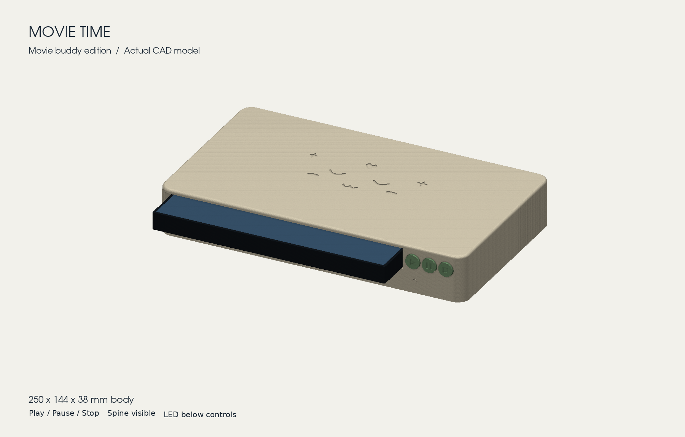

# Movie Time

[](https://github.com/rendyhd/movie-time/actions/workflows/ci.yaml)

A cute NFC movie player for a child’s DVD and Blu-ray cases. Push a case into the
slot and its movie starts in Kodi. Play, Pause and Stop work as labelled; pull the
case out and the movie stops.



## How it works

Each case carries an NFC sticker. Inside the printed player, the original
[Tag Reader for Home Assistant](https://github.com/adonno/tagreader) electronics
(an ESP8266 D1 mini and a red PN532) report which case is inserted and which
button is pressed. A Home Assistant blueprint maps each tag to a movie in the Kodi
library (or a file path Kodi can reach) and controls playback. A PETG spring in
the lid pushes every case against the same guide, so DVD and Blu-ray stickers
line up with the reader.

| You do | Movie Time does |
|---|---|
| Insert a mapped case | Starts that movie from the beginning, once |
| Press Pause, then Play | Pauses, then resumes |
| Press Stop, then Play | Stops, then starts the inserted movie again |
| Remove the case | Stops after about 1.5–2 seconds |
| Wobble the case briefly | Nothing; short dropouts are ignored |
| Insert an unknown case | Starts nothing, and stops the previous case’s movie |
| Reboot or reconnect | Never starts a movie by itself |

## Build your own

1. **Print and assemble the player.** [The hardware guide](hardware/README.md)
   lists the five Bambu Lab A1 prints, screws and parts.
   [The assembly and wiring guide](hardware/ASSEMBLY.md)
   ([PDF](hardware/output/pdf/Movie_Time_Assembly_and_Wiring.pdf)) takes you from
   the first screw to the final checks.
2. **Install the firmware and connect Kodi.** [The setup guide](docs/movie-time-setup.md)
   covers ESPHome, the Kodi blueprint, movie mapping and the checks for a complete
   movie session.
3. **Tag your cases.** Print the
   [NFC sticker template](hardware/output/pdf/Movie_Time_NFC_Sticker_Template_A4.pdf)
   at 100% to mark the same spot on every case.

## What’s in this repository

| Path | Contents |
|---|---|
| [movie-player.yaml](movie-player.yaml) | ESPHome firmware for the original ESP8266 D1 mini |
| [movie_reader.h](movie_reader.h) | Reader logic the firmware needs; keep it beside the YAML |
| [secrets.example.yaml](secrets.example.yaml) | Entries to merge into your private ESPHome secrets file |
| [blueprints/MovieTimeKodi.yaml](blueprints/MovieTimeKodi.yaml) | Home Assistant blueprint: choose your reader, buttons and Kodi player |
| [docs/](docs/movie-time-setup.md) | Setup guide, wiring diagram, and the [review and issue triage](docs/movie-time-review.md) |
| [hardware/](hardware/README.md) | Print files, STEP/STL models, assembly guide and CAD sources |
| [tests/](tests) | Reader state machine, Home Assistant blueprint and firmware compile checks |

## Wiring at a glance

| D1 mini | Connects to |
|---|---|
| D1 / D2 | PN532 SCL / SDA (board set to I²C: switch 1 ON, switch 2 OFF) |
| D8 | WS2812 LED data in |
| D7 | Passive buzzer + |
| D5 / D6 | Play / Pause buttons, closing to GND |
| D0 | Stop button to GND, plus an external 10 kΩ pull-up to 3V3 |
| 5V / GND | PN532 and LED power; every part shares GND |

The [full wiring diagram](docs/movie-time-wiring.png) shows every connection.

## What is tested

The firmware is pinned to **ESPHome 2026.8.2 / ESP8266 Arduino 3.1.2**, and CI
compiles it on every push and pull request. The reader logic has sanitizer-checked C++ tests.
The Kodi blueprint runs in real Home Assistant 2026.8.0 and 2026.9.1 with
simulated Kodi responses. The enclosure was checked digitally for fit, screws,
slicing and spring movement.

Automated checks cannot certify your NFC reception, buzzer, wiring, print
tolerances or movie library. Finish the bench checks in the setup and assembly
guides before closing the player.

This firmware reads existing Home Assistant tag IDs and ordinary tag UIDs.
It deliberately leaves out the original Tag Reader’s music-provider routing and
tag writing; that firmware is still available in
[adonno/tagreader](https://github.com/adonno/tagreader).

## Development checks

```sh
clang++ -std=c++17 -Wall -Wextra -Werror -fsanitize=address,undefined tests/test_reader.cpp -o /tmp/movie-reader-test
/tmp/movie-reader-test
python -m pytest -q tests/test_home_assistant.py
python tests/prepare_compile.py
esphome compile .test-build/movie-player.yaml
```

For the Home Assistant tests use Python 3.14.2+ and
`pip install -r requirements-test.txt homeassistant==2026.9.1`.
Install ESPHome 2026.8.2 in a separate Python 3.12 environment. The compile helper
creates an isolated build using dummy credentials; never flash that test binary.

To rebuild the print files, guide or diagrams, see
[Rebuilding](hardware/README.md#rebuilding) in the hardware guide.

## Credits and license

Movie Time is by [Rendy](https://github.com/rendyhd). It is a modified version of
[Tag Reader for Home Assistant](https://github.com/adonno/tagreader) by Andrea
Donno, Paulus Schoutsen and [contributors](AUTHORS.md), starting from commit
`a8bb6fc` (September 2026). It replaces the firmware configuration, adds the
reader logic, Kodi blueprint, tests, documentation and a printed DVD/Blu-ray
enclosure, and keeps the original electronics and wiring. Like the original, it
is licensed under the [GNU GPL v3](LICENSE).
