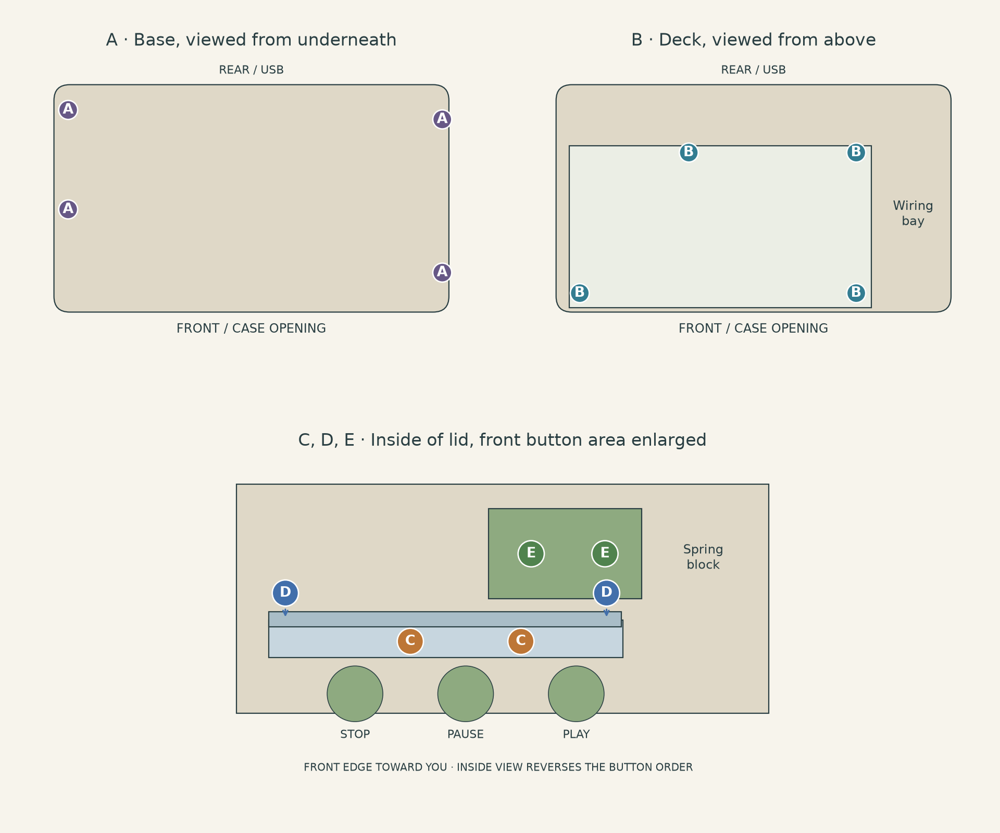
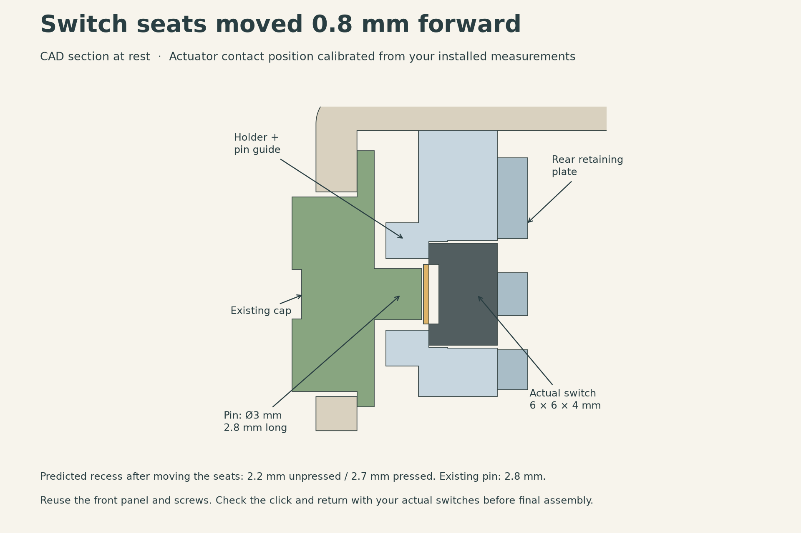
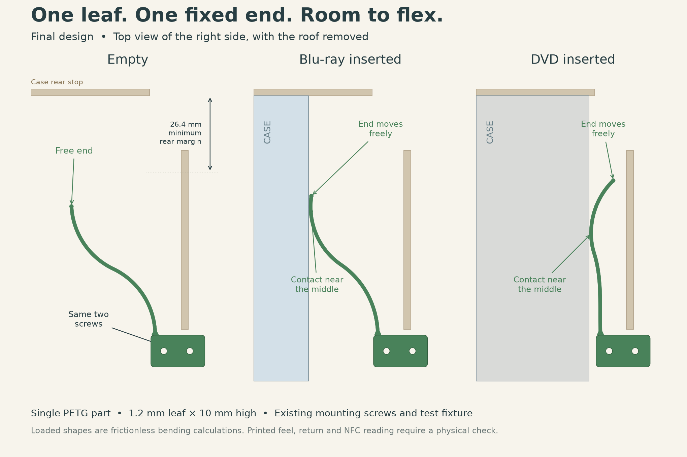
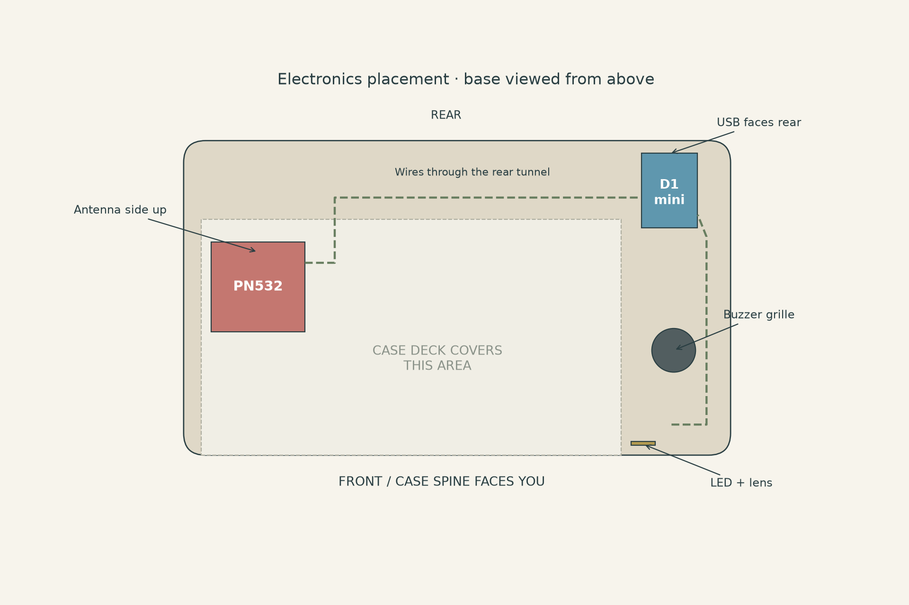
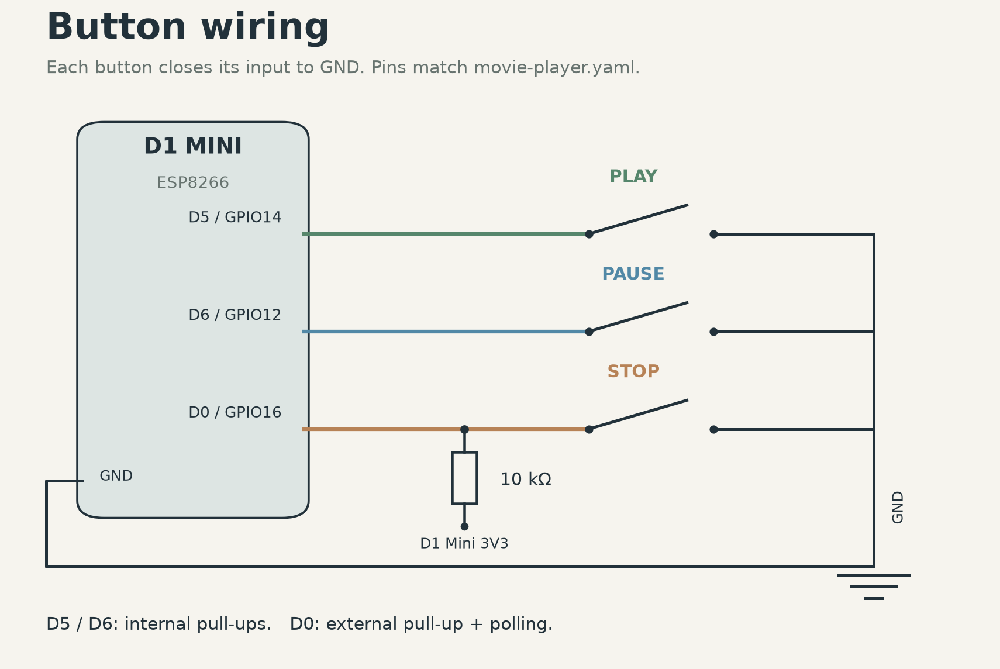
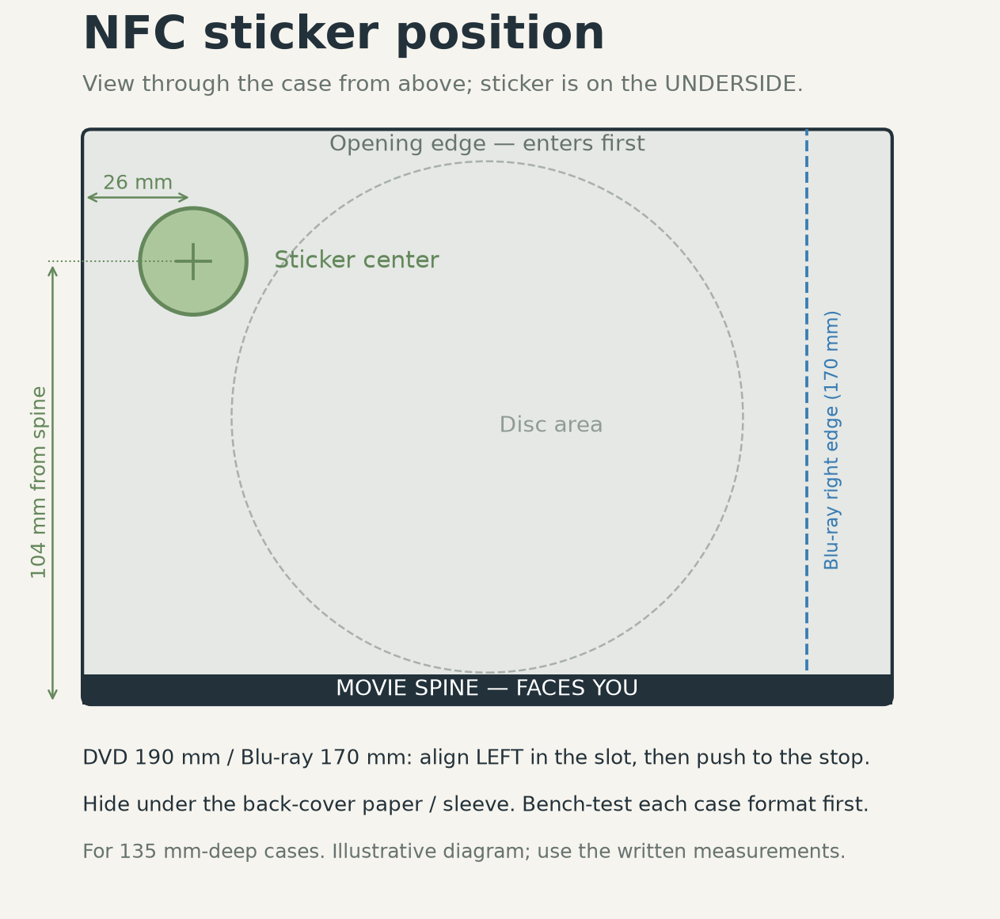

# Movie Time - final assembly and wiring guide

Printable version: [Assembly and wiring PDF](output/pdf/Movie_Time_Assembly_and_Wiring.pdf).
Print files: [output/final_version/plates](output/final_version/plates). See the [hardware README](README.md) for what to print.

## Start here

Movie Time | Final assembly and wiring | Checked 8 September 2026

This guide covers the cute lid, reinforced single PETG spring and revised buttons for your measured switches: **6 x 6 x 4 mm bodies, with 1 mm high, 3.5 mm diameter actuators**. The final player uses 14 screws. Assemble the lid fittings first, then the electronics, case deck and outer shell.

**Screw correction:** use **M2 x 14** for the button holder. The previously listed M2 x 16 reaches the bottom of its blind hole. You can reuse M2 x 16 with a **2 mm spacer under each head**, outside diameter no more than 4 mm. The other listed screw lengths still fit.

### Parts to have ready

| Print project | What it contains |
|---|---|
| 01_Spring_PETG.3mf | Reinforced spring with its integral mounting block |
| 02_Cute_Lid_PLA.3mf | Cute lid, spring bosses and button openings |
| 03_Base_PLA.3mf | Electronics base |
| 04_Deck_and_Hardware_PLA.3mf | Case deck, revised button holder, rear plate and LED lens |
| 05_Buttons_PLA.3mf | Revised play, pause and stop caps with narrow pins |

A full build needs only these five projects. Upgrading an earlier print? Keep your existing caps: **optional/Holder_Reach_Fix_PLA.3mf** contains the new holder and matching rear plate. It moves the switch seats 0.8 mm forward for the measured 3.0 mm unpressed and 3.5 mm pressed recesses. Use 100% scale and the supplied print orientations.

### Sort the screws into five groups

| Code | Qty | Screw | Joins |
|---|---|---|---|
| A | 4 | M3 x 25, pan head | Base to lid, from underneath |
| B | 4 | M3 x 8, 90-degree countersunk | Case deck to base, from above |
| C | 2 | M2 x 14, pan head | Button holder to lid, from inside |
| D | 2 | M2 x 6, pan head | Rear retaining plate to button holder |
| E | 2 | M2 x 12, pan head | Spring mounting block to lid |

Use ordinary metric machine screws, without nuts or heat-set inserts. For pan heads, measure length **from underneath the head to the tip**. For countersunk screws, the 8 mm length **includes the head**. Keep washers out of the stack except for the stated C spacer option.

Also prepare: three kit switches, one 10 kΩ resistor, your original D1 mini / PN532 / WS2812 pixel / passive buzzer, thin flexible wire, heat-shrink, small cable ties, thin foam tape, four rubber feet about 3 mm high, a matching hand screwdriver, soldering tools and a multimeter. Disconnect USB while soldering or moving wires.

## Where the screws go

Match the letters to the screw bags on page 1

| Code | How to insert it |
|---|---|
| A | Through the four base holes from below, upward into the lid posts. |
| B | From the smooth top of the deck, downward into the base pillars. |
| C | Through the two vertical holder holes from inside the open lid, toward the roof. |
| D | Through the rear plate, toward the front panel. These screws run horizontally. |
| E | Through the spring block from inside the lid, toward the roof. |

Choose M2 pan heads no more than **4 mm** across. The A screws need pan heads no more than **6 mm** across. The deck has **6.4 mm diameter, 90-degree countersinks**; use heads that seat flush or below the surface. Check the head drawing if buying a different screw style.

Start each screw straight and turn it gently by hand. These holes form threads in the plastic. Tighten only until the part is secure. If resistance rises before the head seats, back out and check alignment, debris and length. Do not force a screw into the bottom of a blind hole.

## Fit the buttons

Three caps, one holder and one rear retaining plate

1. Dry-fit the switches in the holder. Each body sits in a 6.2 x 6.2 mm pocket, 4 mm deep, with its actuator facing the circular guide. Orient the legs to match the relief slots. Remove the switches again before soldering so the iron cannot soften the PLA.

2. Identify each switch’s two electrical contact groups with a multimeter, then solder and insulate the wires as on page 7. Let the switches cool, refit them and feed the wires through the rear plate slots.

3. Fit the revised rear retaining plate with **two D screws: M2 x 6**, from the rear toward the front. It holds the bodies against the pocket shoulders. The slight pocket clearance is intentional; the plate is needed to stop the switches falling out.

4. Put the lid upside down on a soft surface. Insert the caps from inside through the large front holes. Their flanges stay inside and the small keys point toward the roof. From the outside, the order is **play, pause, stop**.

5. Place the holder behind the caps and guide each narrow pin into its opening. Align its two vertical holes with the lid posts. Fit **two C screws: M2 x 14**, or M2 x 16 with a 2 mm spacer under each head.

6. Check each cap clicks and returns freely. The front faces project 1.4 mm in the model. The measured recesses imply 0.5 mm actuator travel. After moving the switch seats, predicted free play is 0.1 mm and the cap stop remains at 0.7 mm. Check click and return on the new print.

## Fit the PETG spring

The reinforced free-ended leaf mounts directly to the lid

1. Keep the lid upside down. Locate the two spring bosses immediately behind the button holder. The spring’s flat block face sits against those bosses.

2. Orient the leaf so it curves into the case opening, away from the wiring bay. Its free end points toward the back of the player and remains loose. The straight fixed guard separates its movement from the wires.

3. Insert **two E screws: M2 x 12** through the 8 mm block from inside the lid, into the bosses. Tighten gently. The nominal stack gives 4 mm of thread engagement and 0.7 mm before the blind-hole bottom.

4. Leave the entire bending space open. Do not glue the leaf, restrain its free end or install any of the older sliders and tail guides.

### If you use the existing test fixture

The two M2 x 12 screws hold the spring beneath the small PLA bridge. The bridge uses **one M2 x 16 screw** to the test bed. That bridge and its screw are **fixture-only**; the finished lid replaces them. This fixture screw is not the C screw corrected on page 1.

Test DVD and Blu-ray insertion, return and left alignment. Check that the reinforced joint remains intact and the tip stays clear of the right guard. The previous leaf aligned the cases; the latest joint’s printed durability still needs your test.

## Mount the electronics

Work in the open base before fitting the case deck

1. **PN532:** set the red board on the four pads in the left bay, flatter antenna side up toward the case and components down. Keep components off the pads. Use nylon ties through the nearby slots; no metal screw is needed beside the antenna.

2. **D1 mini:** place it between the rails in the rear right bay, USB socket toward the rear opening. Secure it with a tie and thin foam tape where needed. Keep the USB plug and cable strain relief accessible.

3. **Buzzer:** place the original passive buzzer over the bottom sound grille, sound opening toward the grille. Fix it with a small amount of foam tape or a tie, leaving the sound holes clear.

4. **LED:** insert the small lens from inside the front wall so its flange stays inside. Position the WS2812 pixel behind it. Secure and insulate the pixel with tape, keeping its light path clear. White or translucent PLA works best for the lens.

5. Use low soldered wire connections rather than tall plug-in headers under the deck. Route the PN532 wires through the rear tunnel and across the back channel. Keep the button harness on the electronics side of the spring guard. Leave 30-40 mm of slack so the lid can be lifted.

The deck must sit on its supports without pressing on boards, solder joints or wiring. Board clone outlines vary: use the pads and ties as a mounting allowance, and check the actual fit before tightening them.

## Wire the original reader

Use the D1 mini’s printed pin labels, not header position numbers

Movie Time keeps the original tagreader connections. The mapping below was checked against adonno’s schematic and matches movie-player.yaml. The original red PN532 board is powered from 5V; the D1 mini’s signal pins use 3.3V logic. [1-3]

| D1 mini connection | Connect to | Detail |
|---|---|---|
| 5V | PN532 VCC | Original red PN532 module |
| G / GND | PN532 GND | Common ground |
| D1 / GPIO5 | PN532 SCL | I²C clock |
| D2 / GPIO4 | PN532 SDA | I²C data |
| 5V | WS2812 5V / VDD | Pixel power |
| G / GND | WS2812 GND / VSS | Pixel ground |
| D8 / GPIO15 | WS2812 DIN / DI | Use the data input end, not DOUT |
| D7 / GPIO13 | Original passive buzzer + | Keep the original buzzer type |
| G / GND | Buzzer - | Common ground |

### Set the PN532 to I²C

On the original board, set **switch 1 ON and switch 2 OFF**. Use the four connections marked SCL, SDA, VCC and GND. The project does not need separate IRQ or RST wires. [1]

### Make the connections

1. Unplug USB. Read the labels on both boards before soldering; clone layouts can place the same pins in different positions.

2. Join the grounds together. Make neat, insulated branches for the shared 5V supply to the PN532 and pixel. Keep bare joints and loose strands away from neighbouring pads.

3. Connect SCL, SDA, pixel DIN and buzzer + as in the table. Label both ends of any wires that will be hidden under the deck.

4. Inspect the solder joints and check for accidental shorts before applying USB power. Test the reader, buzzer and LED with the firmware (page 8) while the deck is still off.

The button circuit uses **3.3V logic**. The 10 kΩ pull-up goes to 3V3, the switches close to GND, and their signal wires go to D0, D5 and D6 as on page 7. Never put 5V onto those inputs. Power the reader through its existing USB connection. [3]

Sources: [1] [adonno/tagreader](https://github.com/adonno/tagreader); [2] [original wiring schematic](https://github.com/adonno/tagreader/blob/master/Schematics/tag_reader_schematics_v3.2.png); [3] [WEMOS pin and voltage documentation](https://www.wemos.cc/en/latest/d1/d1_mini.html).

## Wire the three buttons

Four wires go to the lid: ground, play, pause and stop

| Control | Signal side | Other side |
|---|---|---|
| Play | D5 / GPIO14 | GND |
| Pause | D6 / GPIO12 | GND |
| Stop | D0 / GPIO16 | GND |
| Stop pull-up | One end of 10 kΩ to 3V3 | Other end to D0, shared with stop |

A four-leg tactile switch has two internally joined groups. With USB disconnected and the switch loose, find a pair of legs that reads open when released and near zero ohms when pressed. Use that pair, one wire on each group. Do not choose two legs that are permanently connected, and do not infer the groups from appearance alone.

D5 and D6 get internal pull-ups from the supplied software. **D0 has no internal pull-up**, so stop needs the external 10 kΩ. Its software uses polling because GPIO16 does not support GPIO interrupts. [4,5]

Your kit resistor can be 1/8 W or 1/4 W. Typical 10 kΩ markings are **brown-black-orange-gold** (four bands) or **brown-black-black-red-brown** (five bands). Measure it loose to confirm roughly 10,000 Ω. Resistors have no polarity. [6]

After soldering, insulate the joints and tie the four-wire harness away from the spring. Check every switch still changes between open and closed before attaching it to the D1 mini.

## Install the firmware

movie-player.yaml runs the reader and buttons; Home Assistant starts the movie in Kodi

1. Put **movie-player.yaml** and **movie_reader.h** from the top of the repository together in your ESPHome configuration folder. Merge the four entries from **secrets.example.yaml** into your secrets.yaml. Keep a copy of any previous device YAML for rollback.

2. This one file already includes the reader, LED, buzzer and all three buttons. **Do not add the older movie_buttons.yaml package or an upstream tagreader package** alongside it.

3. Compile with ESPHome **2026.8.2** and install over a micro-USB data cable; later updates can use OTA. Add or reconnect the reader in Home Assistant’s ESPHome integration. It does not need the “Allow the device to perform Home Assistant actions” option.

4. With the deck still off, check that **Reader Healthy** is on, **Selected Tag** changes when a tagged case goes in and clears after removal, and **Play Button**, **Pause Button** and **Stop Button** each change off, on, off. **Test LED** and **Test Buzzer** check the feedback parts.

5. Import **blueprints/MovieTimeKodi.yaml**, create the **Movie Time Active Tag** text helper and map each tag to a Kodi movie, as described in the setup guide. [7,8]

| Physical input | Firmware entity | What Kodi does |
|---|---|---|
| Play | Play Button | Resumes when paused; starts the inserted case again after Stop |
| Pause | Pause Button | Pauses; pressing again does not resume |
| Stop | Stop Button | Stops, keeping the case selected for Play |
| Case removed | Selected Tag clears | Stops after about 1.5-2 seconds |

### If a button clicks but nothing happens

Watch that button’s entity in Home Assistant. If it does not change, check the input wiring; Stop also needs its 10 kΩ pull-up to 3V3. If it changes but Kodi does not respond, check the blueprint’s entity choices, Kodi availability and the automation trace. [7,8]

Installation, movie mapping and the full session checks are in the [Movie Time setup guide](https://github.com/rendyhd/movie-time/blob/main/docs/movie-time-setup.md). The firmware is tested with ESPHome **2026.8.2** / ESP8266 Arduino 3.1.2. Compilation and simulated Home Assistant tests do not replace the physical checks in this guide.

## Fit the deck, test and close

B screws for the deck, then A screws for the outer shell

1. Unplug USB. Set the deck over the electronics, **smooth side up and reinforcing ribs down**. The thin antenna area goes over the PN532. Make sure the deck rests flat without trapping wires.

2. Fit **four B screws: M3 x 8, 90-degree countersunk**, from the top. Their heads must finish flush or recessed so they cannot scratch a case. Do not substitute pan heads here.

3. For a 135 mm-deep case, view it with the front cover up and spine toward you. The tag centre is **26 mm from that left short edge and 104 mm from the spine**. Temporarily place the sticker on the underside/back-cover side directly beneath that point. Keep the case against the left guide.

4. Set the completed lid on the base without the A screws, with wires clear of the spring. Reconnect USB and test DVD and Blu-ray cases, including any disc and sleeve you intend to keep. Confirm reads, left alignment and all three controls. Fix stickers permanently only after testing each case format.

5. Unplug USB and make the final wire check. Seat the lid with the rear alignment pins engaged, the spring clear and the harness tucked into the right bay. The lid should meet the base without screw force.

6. Fit **four A screws: M3 x 25 pan head**, through the base from underneath. Start all four loosely, then snug them evenly. Add four rubber feet about 3 mm high, clear of the sound grille and screw access. Reconnect USB and repeat the functional check with the shell closed.

## Final checks and reference

Use this page beside the assembled player

| Check | What you should see |
|---|---|
| Buttons | All three caps click, release freely and trigger the intended action. |
| Case movement | DVD and Blu-ray cases reach the rear stop; the spring returns after removal. |
| Spring attachment | No cracking at the reinforced joint; the free end stays clear of wires. |
| Deck and shell | Deck heads are flush, no trapped wire, lid seats evenly and feet are stable. |
| NFC | Each selected case reads reliably through the closed player. |
| Before handing it over | Lid secured, internal parts inaccessible, USB lead kept out of the loading slot. |

### Quick troubleshooting

| Symptom | Check first |
|---|---|
| Switch falls out | Fit the revised rear retaining plate with the two D screws. |
| Cap cannot reach the switch | Use the revised cap with a full-length 3 mm pin and its matching holder. |
| Cap sticks / stays pressed | Check its key and guide alignment, burrs, switch seating and free play. Do not force it. |
| Stop input floats or triggers alone | Check the 10 kΩ connection from D0 to 3V3 and the common ground. |
| No NFC read | Check PN532 mode, SCL/SDA, antenna facing up and sticker position; retest without the case. |
| Screw tightens before the part seats | Check length and alignment. C uses 14 mm, or 16 mm plus a 2 mm spacer. |

### What was double-checked

The released CAD was checked for all 14 nominal screw envelopes, unrelated-part clearance and blind-hole margins. Button body retention, pin travel and current part clearances were checked; the supplied A1 plates are sliced. Wiring was checked against the original project and official pin documentation. Printed tolerances, spring fatigue, switch travel, NFC read range and child operating force still require the physical checks above.

### Primary references

[1] [Tagreader project and PN532 mode](https://github.com/adonno/tagreader) · [2] [Original wiring schematic](https://github.com/adonno/tagreader/blob/master/Schematics/tag_reader_schematics_v3.2.png) · [3] [WEMOS D1 mini](https://www.wemos.cc/en/latest/d1/d1_mini.html)

[4] [ESPHome ESP8266 pin restrictions](https://esphome.io/components/esp8266/) · [5] [ESP8266 GPIO interrupts](https://arduino-esp8266.readthedocs.io/en/3.0.0/reference.html) · [6] [Vishay resistor colour code](https://www.vishay.com/docs/20143/colorcod.pdf)

[7] [Movie Time setup guide](https://github.com/rendyhd/movie-time/blob/main/docs/movie-time-setup.md) · [8] [Home Assistant Kodi integration](https://www.home-assistant.io/integrations/kodi/). CAD and hardware records: hardware/output/final_version/validation/assembly_audit.json.
