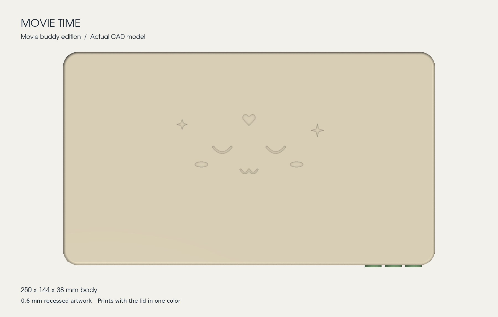

# Movie Time hardware

The printed player for Movie Time: enclosure, PETG case spring, buttons, wiring
and assembly guide. The firmware and Home Assistant blueprint are at the top of
this repository; set them up with [the setup guide](../docs/movie-time-setup.md).

The body is 250 × 144 × 38 mm, with a sleepy face, heart and sparkles. Standard
DVD and plastic Blu-ray cases enter horizontally with the spine visible: 108 mm
inside, 27 mm exposed. One free-ended PETG leaf in the lid pushes the case
against the left guide so its NFC sticker lines up with the reader. Play, Pause
and Stop are separate printed caps over 6 mm tactile switches.

**Build it with [the assembly and wiring guide](ASSEMBLY.md)**
([printable PDF](output/pdf/Movie_Time_Assembly_and_Wiring.pdf)). It covers the
screws, buttons, spring, electronics, wiring, firmware and final checks.

## Print

All projects are for a **Bambu Lab A1 with a 0.4 mm nozzle**: 0.20 mm layers,
100% scale, supports off, parts already oriented on the bed. Select your actual
PLA or PETG filament profile but keep the supplied orientation and infill. Use
unfilled PETG for the spring. Leave traditional timelapse off; the slicer reports
a parking-clearance advisory for these plates.

| Project | Material | Contents | Estimate |
|---|---|---|---|
| [01_Spring_PETG.3mf](output/final_version/plates/01_Spring_PETG.3mf) | PETG, solid infill | Reinforced single-leaf spring with its integral mounting block | 2.8 g, 20 min |
| [02_Cute_Lid_PLA.3mf](output/final_version/plates/02_Cute_Lid_PLA.3mf) | PLA | Lid with face, spring bosses and button openings | 135 g, 4 h 16 min |
| [03_Base_PLA.3mf](output/final_version/plates/03_Base_PLA.3mf) | PLA | Electronics base | 165 g, 5 h 18 min |
| [04_Deck_and_Hardware_PLA.3mf](output/final_version/plates/04_Deck_and_Hardware_PLA.3mf) | PLA | Case deck, button holder, rear retaining plate and LED lens | 58 g, 2 h 2 min |
| [05_Buttons_PLA.3mf](output/final_version/plates/05_Buttons_PLA.3mf) | PLA | Play, pause and stop caps | 1.7 g, 14 min |

PLA parts use 15% infill. White or translucent PLA works best for the LED lens.
STEP files (assembly coordinates) and STL files (print orientation) for every
part are in [output/final_version/step](output/final_version/step) and
[output/final_version/stl](output/final_version/stl).

Optional prints in [output/final_version/optional](output/final_version/optional):

| Project | Use it for |
|---|---|
| Button_and_case_fit_PLA.3mf | Checking button and case fit before the large prints (22 g, 1 h 16 min) |
| Spring_test_fixture_PLA.3mf | Trying the spring with your cases before printing the lid. Its bridge uses one M2 × 16 screw, and the spring fits with the same two M2 × 12 screws |
| Holder_Reach_Fix_PLA.3mf | **Only for an earlier print:** a new holder and rear plate that move the switch seats 0.8 mm forward, so existing caps reach the switches (3.8 g, 23 min) |

## Other parts

- Original Tag Reader electronics: ESP8266 D1 mini, red PN532 NFC board, WS2812
  pixel and passive buzzer
- Three tactile switches, 6 × 6 × 4 mm bodies with 1 mm high, 3.5 mm diameter actuators
- One 10 kΩ resistor (Stop pull-up to 3V3)
- Screws: 4 × M3 × 25 pan head, 4 × M3 × 8 90° countersunk, 2 × M2 × 14 pan
  head, 2 × M2 × 6 pan head, 2 × M2 × 12 pan head. No nuts or inserts; the screws
  form threads in the plastic
- Thin flexible wire, heat-shrink, small cable ties, thin foam tape and four
  rubber feet about 3 mm high
- NTAG213/215 stickers for the cases

The [complete wiring diagram](output/preview/complete_wiring.png) is the same
one used in the setup guide. Print the
[NFC sticker template](output/pdf/Movie_Time_NFC_Sticker_Template_A4.pdf) at
100% to mark the sticker position on each case.

## What has been checked

Digitally: final solids and meshes, A1 slicing, all 14 screw envelopes and
blind-hole margins, button retention and travel, and a large-rotation bending
model of the leaf against DVD and Blu-ray cases at left, centre and right
insertion positions. The records are in
[output/final_version/validation](output/final_version/validation) and date from
the 8 September 2026 release. `SHA256.json` lists that release's sources;
the guide's firmware page and wiring labels were updated afterwards to match
this repository's firmware.

Still to confirm on a real print: the reinforced spring joint's durability (the
previous leaf aligned both case types), button click and return with the revised
holder, NFC read range and a suitable operating force for a child. The final
checks in the assembly guide cover these.

## Rebuilding

The parametric CadQuery sources and check scripts are in [model](model). Use
Python 3.12 with `pip install -r requirements.txt`. The slicing scripts call
the Bambu Studio CLI at its macOS install path.

| Output | Script |
|---|---|
| Assembly guide PDF and [ASSEMBLY.md](ASSEMBLY.md) | `python model/assembly_guide/build_guide.py`; edit the text in `content.py` |
| Button wiring and tag placement diagrams | `python model/draw_guides.py` |
| Complete wiring diagram | `python model/draw_complete_wiring.py`, then copy it to `../docs/movie-time-wiring.png` |
| NFC sticker template | `python model/create_nfc_sticker_template.py` |

The CAD was built in stages. `build_model.py` and `parameters.json` define the
original base, deck, lid and buttons; `final_version/` adds the single PETG leaf
and the lid that carries it; `button_fit_fix/` revises the caps, holder and rear
plate for the measured switches. Each later stage reads STEP, STL and plate
files written by the earlier ones under `output/`. Only the final release files
are committed, so run the earlier stages first. `final_version/compare_force.py`,
`root_preview.py` and `package.py` also compare against archived earlier
releases that are not in this repository.

`spring_guide/`, `spring_guide_v2/` and `spring_guide_v3/` are superseded spring
prototypes, kept for their history: the first spring's end caught behind the
case, the second worked for Blu-ray but jammed with DVDs, and the third's slider
stayed pressed. Later stages still use the test fixture and slicing helper from
`spring_guide/`.
